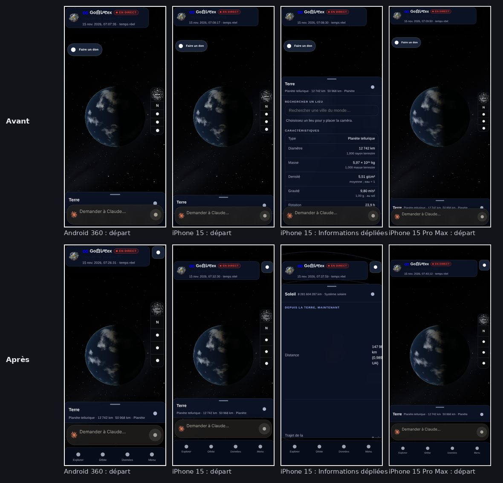
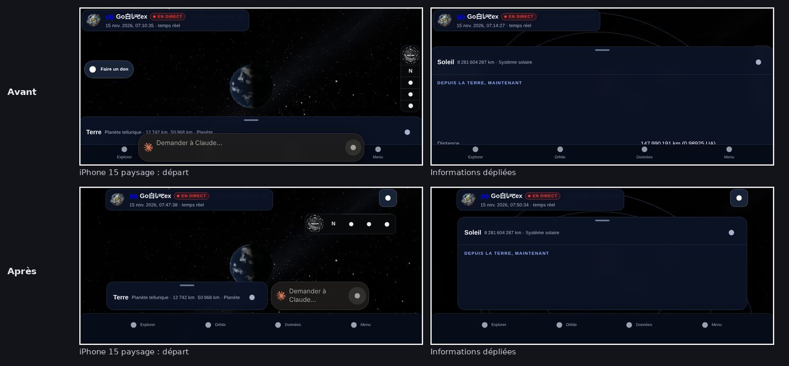
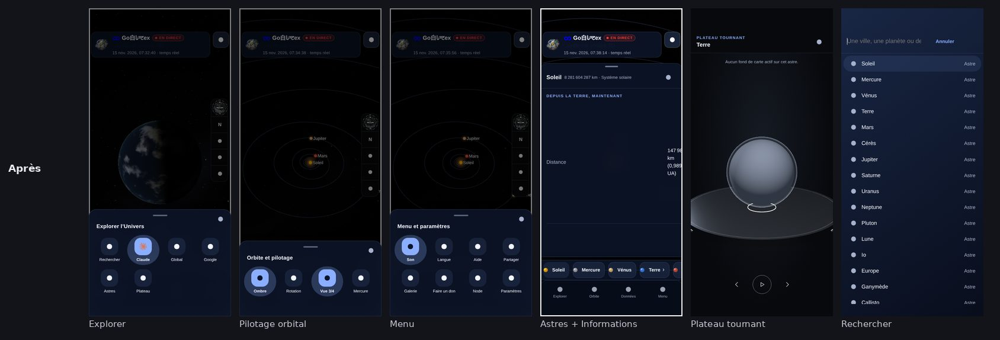
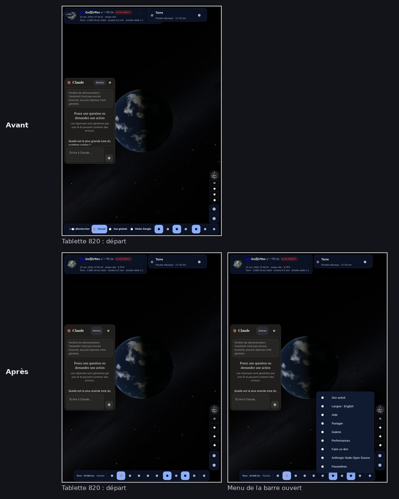

# Refonte ergonomique et structurelle de l'interface mobile — Gobai Space

Rapport de la mission « refonte ergonomique et structurelle de l'interface mobile ». Objectif : toutes les fonctions de
l'ordinateur utilisables au doigt, aucun bouton caché ni recouvert, rien qui se chevauche, en portrait comme en
paysage, sur téléphone comme sur tablette, sans toucher à la scène 3D.

## Ce qui a été fait, et ce qui est seulement proposé

**Corrections faites** (dans le code, vérifiées sur le banc) :
- Écran du téléphone découpé en deux zones mesurées (titre en haut, dock en bas) : les barres s'empilent au lieu de
  se recouvrir.
- Navigation mobile de nouveau atteignable : ses quatre onglets étaient tous recouverts par la barre de Claude en
  portrait.
- Plateau tournant, arborescence des astres et moniteur de performance : chacun a de nouveau un bouton.
- Barre de l'ordinateur et de la tablette : toujours entière (icônes sous 1 200 px, menu « Menu » si elle ne tient
  toujours pas).
- Fenêtres et feuilles : une seule ouverte à la fois, bouton Fermer de 44 px toujours visible et hors de l'encoche,
  plein écran sans débordement.
- Cibles tactiles de 44 px au moins sur écran tactile (thème, navball, Claude, astres, langue, galerie).
- Bandeau du titre de l'ordinateur : compteur d'images et moniteur dedans, plus de chevauchement avec le panneau
  d'informations.
- Outil de contrôle des collisions intégré à l'application (`?diagnostic=interface`), avec tests.

**Seulement proposé** (non fait) : voir « Améliorations proposées » en fin de rapport.

## Méthode

- Lecture de tout le HUD : `SolarScene.jsx`, barre d'outils (`toolbar/`), bandeaux et indicateurs (`hud/`), fenêtres
  (`menus/`, `scene/`), thème et mise en page (`theme/`).
- **Banc d'essai** (hors dépôt) : l'application réelle, compilée avec esbuild, rendue dans Chrome sans écran
  (puppeteer, WebGL par SwiftShader), avec de vrais appuis tactiles au centre de chaque bouton. Un bouton recouvert ne
  reçoit donc pas l'appui, comme sous un doigt.
- MUI ne peut pas être installé ici (réseau fermé). Le banc le remplace par un substitut qui applique les `sx` et les
  surcharges du thème. Les mesures de mise en page sont celles du code du projet ; le dessin fin des composants MUI
  peut différer de quelques pixels.
- Données des astres et des villes : tirées du serveur du dépôt et servies localement. Pas de tuiles (réseau fermé).
- **Neuf écrans** :

  | Écran | Taille (points CSS) | Zones de sécurité |
  | --- | --- | --- |
  | Ordinateur | 1 440 × 900 | — |
  | Ordinateur | 1 024 × 768 | — |
  | Android | 360 × 780 | — |
  | iPhone 15 | 393 × 852 | haut 59, bas 34 |
  | Android | 412 × 915 | — |
  | iPhone 15 Pro Max | 430 × 932 | haut 59, bas 34 |
  | iPhone 15, paysage | 852 × 393 | gauche et droite 59, bas 21 |
  | Android, paysage | 780 × 360 | — |
  | Tablette | 820 × 1 180 | — |

  Écrans tactiles : pointeur grossier ; ordinateurs : souris.
- **Scénario, identique avant et après** :
  - chaque onglet de la navigation mobile, puis chaque bouton de chaque feuille ;
  - sur ordinateur et tablette, chaque bouton de la barre et chaque entrée de son menu ;
  - pour chacun : ouverture, contrôle des collisions, fermeture par le bouton Fermer (sinon Échap) ; les bascules
    sont remises en place ;
  - puis les états : panneau Informations déplié, arborescence des astres, les deux ensemble, rotation de l'écran.
- « Avant » : la branche `main` (8504b3d). « Après » : cette branche. Même banc, même scénario.

## Inventaire des composants interactifs

- **Dans le code**, avant : 156 commandes déclarées en JSX dans 41 fichiers :
  - 23 `button` natifs, 23 `Button`, 22 `Chip`, 19 `Switch`, 13 `TextField` ;
  - 10 `IconButton`, 9 `ToggleButton`, 9 `Tab`, 7 `Link`, 6 `MenuItem` ;
  - 4 `ListItemButton`, 3 liens `a`, 2 `Slider`, 2 `InputBase`, 2 `Checkbox`, 1 `select`, 1 `input`.
- Après : 158 dans 42 fichiers.
  - Ajoutés : le cœur « Faire un don » de la zone du titre, le bouton « Menu » de la barre et son menu.
  - Retiré : le bouton flottant « Faire un don ».
- **Actions générées** par `toolbarActions.jsx` : 20, dont 2 ajoutées (Astres, Plateau tournant). « Contribuer » n'est
  jamais branchée (voir anomalies restantes).
- **Comptées à l'écran par le banc** (commandes rendues, mesurées) :
  - départ : 12 sur téléphone, 33 sur ordinateur, 27 sur tablette ;
  - feuilles du téléphone : 12 à 19 ;
  - avec une fenêtre ouverte : jusqu'à 83 commandes sur la page au téléphone, et 97 sur ordinateur. Ce compte
    comprend la fenêtre et ce qu'elle couvre (« Anthropic Node Open Source »).

## Anomalies relevées et causes

| # | Anomalie (mesurée sur `main`) | Écrans | Cause |
| --- | --- | --- | --- |
| A1 | Les quatre onglets de navigation (Explorer, Pilotage orbital, Données et sources, Menu) sont recouverts par la barre de Claude. Aucune action de la barre n'est atteignable, puisqu'elles sont toutes derrière ces onglets. | Téléphones en portrait | Chaque élément du bas (bande des astres, barre de Claude, tiroir, navigation) avait sa propre position fixe, calculée à partir de constantes (`BOTTOM_STACK`, `STRIP_H`…) qui supposaient la hauteur des autres. Aucune mesure commune. |
| A2 | La barre de Claude chevauche Explorer et Menu ; Pilotage et Données sont en partie recouverts (leur centre reste atteignable). | Téléphones en paysage | Même cause. |
| A3 | Le panneau Informations déplié recouvre les quatre boutons de la navball. | Téléphones | La navball était placée sans connaître la hauteur du panneau. |
| A4 | Boutons de la navball de 48 × 28, pastille « Astres » de 60 × 28, croix de Claude de 28 × 28, onglets et entrées de menu de 42 px. | Écrans tactiles | Tailles pensées pour la souris, sans règle pour le pointeur grossier. |
| A5 | Plateau tournant inaccessible au doigt. | Tous | `onPlateau` arrivait jusqu'à la barre, mais aucune action ne l'utilisait. Seule la touche T l'ouvrait. |
| A6 | Arborescence des astres inaccessible quand Claude est masqué. | Tous | Son seul bouton était la pastille « Astres » dans le panneau de Claude. |
| A7 | Bouton « Performances » absent. | Ordinateur | `Toolbar` recevait `onTogglePerformanceMonitor` mais ne le transmettait pas. |
| A8 | Les cinq derniers boutons de la barre (Partager, Galerie, Faire un don, Node, Paramètres) sont au bout d'un défilement horizontal sans barre visible, et le doigt ne les atteint pas. | Tablette en portrait | Barre sur une seule ligne, sans contrôle de la place. Avec des cibles de 44 px et les libellés, elle dépasse les 792 px disponibles. |
| A9 | Bouton « Revenir au globe de l'app » à 12 px du haut, sous l'encoche ou la Dynamic Island ; la fenêtre n'est pas déclarée modale. | iPhone | Position fixe sans marge de sécurité ; pas d'`aria-modal`. |
| A10 | Fenêtres plein écran (Rechercher, Langue, Aide, Galerie, Paramètres…) : en-tête et bouton Fermer sous l'encoche. | iPhone | Le thème ne donnait aucune marge de sécurité à `paperFullScreen`. |
| A11 | Plateau tournant en paysage : les commandes (◀ ▶ lecture) sortent de l'écran. | Téléphones en paysage | Bloc du globe de hauteur fixe dans une fenêtre plus basse que lui. |
| A12 | Bouton flottant « Faire un don » posé sur la scène. | Téléphones | Position fixe propre, hors de toute zone réservée. |
| A13 | Messages temporaires (toasts) sans largeur maximale, qui captent les appuis sur toute leur boîte. | Téléphones | `width` et `pointerEvents` écrits à l'intérieur d'un commentaire, donc jamais appliqués. |
| A14 | Le compteur d'images recouvre le logo. Sur tablette en portrait, le bandeau du titre passe sous le panneau d'informations (≈ 70 px). | Ordinateur, tablette | Deux éléments en position fixe aux mêmes coordonnées ; bandeau sans largeur maximale tenant compte du panneau. |
| A15 | Pastilles, onglets, bouton « Charger plus », croix et téléchargement de la galerie sous 44 px. Bouton « ⤓ zip » de 22 px sur ordinateur (sous les 24 px de WCAG 2.5.8). | Écrans tactiles, ordinateur | Feuille de style de la galerie sans règle pour le pointeur grossier. |
| A16 | Feuilles d'actions sans bouton de fermeture visible : il fallait tirer la poignée, toucher le voile ou presser Échap. En paysage, le voile n'est visible que sur une bande étroite. | Téléphones | Fermeture laissée aux seuls gestes. |

## Architecture retenue

**Zones de l'écran du téléphone** (`ui/MobileZones.jsx`, `hooks/useZones.jsx`, `theme/layout.jsx`)
- `MobileTopBar` en haut : le bandeau du titre, le cœur « Faire un don » (44 px) à sa droite, puis les indicateurs
  (tuiles, LiDAR) en dessous.
- `MobileDock` en bas : d'abord les surfaces (tiroir Informations, barre de Claude), puis la base (bande des astres,
  navigation).
- Tout est posé dans le flux : rien ne peut se recouvrir, quel que soit le nombre de barres ouvertes.
- À partir de 700 px de large (paysage), les deux surfaces se partagent une rangée.
- Le dock remonte au-dessus du clavier virtuel (`visualViewport`).
- Une surface ne dépasse jamais la place libre (`DOCK_SURFACE_MAX`, en `dvh`) : elle défile en interne, et son en-tête
  (bouton Réduire) reste visible.
- Les deux zones **mesurent leur place réelle** (`ResizeObserver`, rotation, clavier) et la publient : variables CSS
  `--hud-top`, `--hud-bottom`, `--dock-base`, et un petit magasin.
- La navball, le cadre GPS, les messages et le moteur (coins visibles) se placent dans l'espace libre entre les deux.
  La navball passe en rangée quand la colonne ne tient pas, et s'efface s'il n'y a pas de place.
- Les zones laissent passer les gestes vers la scène 3D partout où elles n'affichent rien (`pointer-events`).
- Marges de sécurité lues partout par `safe(côté)` : `env(safe-area-inset-*)`, remplaçables pour les tests.

**Navigation hiérarchique et fenêtres centralisées**
- Téléphone : quatre onglets → feuilles d'actions. Chaque action de l'ordinateur a sa place (tableau plus bas).
- `usePanels` ouvre les fenêtres : une seule à la fois, ouverture et bascule au même endroit (`show`, `toggle`).
- Fenêtres plein écran du téléphone : marges de sécurité sur les quatre côtés, bouton Fermer de 44 px.
- Feuilles d'actions : bouton Fermer de 44 px en haut à droite, en plus de la poignée, du voile et d'Échap. Leur
  contenu défile à l'intérieur ; elles ne dépassent jamais l'écran.

**Ordinateur et tablette**
- Barre en icônes sous 1 200 px.
- Si elle ne tient toujours pas, le groupe « help » (son, langue, aide, partage, galerie, performances, dons, sources,
  paramètres) passe dans un menu « Menu ».
  - Repli : dès que la barre déborde (après chaque rendu, ou quand un de ses éléments ou la fenêtre change de
    taille).
  - Dépli : seulement quand la fenêtre s'élargit assez. La barre ne peut donc pas se replier et se déplier sans fin.
- Dans ce menu, les bascules sont des cases à cocher (`menuitemcheckbox`, `aria-checked`).
- Le bandeau du titre contient le compteur d'images et le moniteur de performance. Sa largeur s'arrête avant le
  panneau d'informations.

**Cibles tactiles** : règles `@media (pointer: coarse)` dans le thème et la galerie, et `MQ.coarse` dans les
composants. 44 px au moins, sans rien changer à la souris.

**Contrôle des collisions** (`diagnostic/layoutAudit.jsx`, `DiagnosticInterface.jsx`)
- Partie pure, testée : recouvrement de deux rectangles ; liste des commandes hors écran, recouvertes, chevauchées,
  trop petites ou au libellé coupé.
- Partie navigateur :
  - chaque commande rendue est essayée en cinq points avec `elementFromPoint` ;
  - exemptées : fenêtre modale ouverte, conteneur à faire défiler, commande désactivée, ancêtres ;
  - rectangles rognés par leur conteneur ;
  - cible minimale de 44 px au doigt, 24 px à la souris ;
  - lien dans le texte exempté (WCAG 2.5.8) ;
  - libellé coupé seulement si c'est bien du texte qui dépasse.
- `?diagnostic=interface` dans l'adresse : cadres colorés sur l'écran réel, recalculés toutes les 1,5 s, et un
  encart des nombres. `window.gobaiDiagnostic()` renvoie l'analyse.

## Où se trouve chaque action sur téléphone

Toutes les fonctions de l'ordinateur sont présentes sur téléphone. Le chemin d'accès est indiqué pour chacune.

| Fonction | Ordinateur | Téléphone |
| --- | --- | --- |
| Rechercher, Claude, Vue globale | barre | onglet Explorer |
| Astres (arborescence) | barre *(nouveau)* | onglet Explorer *(nouveau)* ; pastille « Astres » de Claude |
| Plateau tournant | barre *(nouveau)* ; touche T | onglet Explorer *(nouveau)* |
| Ombre, Rotation, Vue 3/4, Verrouillage de l'astre | barre | onglet Pilotage orbital |
| Performances | barre *(nouveau)*, dans le menu « Menu » si la barre est repliée | onglet Données et sources (mesures en direct) |
| Son, Langue, Aide, Partager, Galerie | barre, ou menu « Menu » | onglet Menu |
| Faire un don | barre, ou menu « Menu » | cœur de la zone du titre ; onglet Menu |
| Anthropic Node Open Source, Paramètres | barre, ou menu « Menu » | onglet Menu |
| Informations (déplier, réduire, cartes) | panneau en haut à droite | tiroir du dock |
| Claude (saisie, envoi) | panneau à gauche | barre du dock |
| Bande des astres | rail à gauche | bande du dock |
| Verrou du nord, Ma position | navball | navball (colonne ou rangée) |
| Zoom | pavé de zoom | pincement ; deux modes de la navball (zoom en penchant le téléphone) |

## Validation

> Mise à jour : le Globe Google (fenêtre Google Earth) a été retiré de l'app depuis ce rapport. Les tableaux
> ci-dessous datent d'avant ce retrait et le comptent encore.

**En bref**
- Après : 220 commandes essayées sur les neuf écrans, 220 réussies.
- Après : 85 états mesurés, aucun avec une commande recouverte, chevauchée, hors écran ou trop petite.
- Avant : 83 réussies sur 104 essayées, et 21 états en défaut sur 37.
- Avant, sur les quatre téléphones en portrait, le scénario s'arrête aux onglets : ils sont tous recouverts. Aucune
  des 18 actions des feuilles n'est donc atteignable.
- Les ordinateurs n'avaient pas de défaut de place dans les états mesurés. Ils gagnent trois commandes : Astres,
  Plateau tournant, Performances.

États mesurés sur chaque écran :
- départ ;
- chaque feuille du téléphone, et la feuille « Données » avec les mesures dépliées ;
- le menu de la barre (tablette) ;
- panneau Informations déplié ;
- arborescence des astres ouverte, seule puis avec Informations dépliées ;
- rotation de l'écran avec l'arborescence ouverte, puis retour et rotation.

Chaque fenêtre ouverte est aussi mesurée : 81 fenêtres après.

#### Par écran

| Écran | Commandes essayées (avant → après) | Réussies avant | Réussies après | Recouvertes, pire état (avant → après) | Chevauchements, pire état | Hors écran, pire état | Cibles trop petites au départ | États mesurés après | Défaut dans un état après |
| --- | --- | --- | --- | --- | --- | --- | --- | --- | --- |
| Ordinateur 1440 | 16 → 19 | 16/16 | 19/19 | 0 → 0 | 0 → 0 | 0 → 0 | 0 → 0 | 6 | 0 |
| Ordinateur 1024 | 16 → 19 | 16/16 | 19/19 | 0 → 0 | 0 → 0 | 0 → 0 | 0 → 0 | 6 | 0 |
| Android 360 | 4 → 27 | 0/4 | 27/27 | 8 → 0 | 0 → 0 | 0 → 0 | 4 → 0 | 11 | 0 |
| iPhone 15 | 4 → 27 | 0/4 | 27/27 | 8 → 0 | 0 → 0 | 0 → 0 | 4 → 0 | 11 | 0 |
| Android 412 | 4 → 27 | 0/4 | 27/27 | 8 → 0 | 0 → 0 | 0 → 0 | 4 → 0 | 11 | 0 |
| iPhone 15 Pro Max | 4 → 27 | 0/4 | 27/27 | 8 → 0 | 0 → 0 | 0 → 0 | 4 → 0 | 11 | 0 |
| iPhone 15 paysage | 20 → 27 | 20/20 | 27/27 | 5 → 0 | 2 → 0 | 0 → 0 | 4 → 0 | 11 | 0 |
| Android paysage | 20 → 27 | 20/20 | 27/27 | 5 → 0 | 2 → 0 | 0 → 0 | 4 → 0 | 11 | 0 |
| Tablette 820 | 16 → 20 | 11/16 | 20/20 | 0 → 0 | 0 → 0 | 0 → 0 | 6 → 0 | 7 | 0 |

« Réussie » : la commande est atteinte au centre par un appui réel et fait ce qu'elle doit. Cela veut dire : la
fenêtre s'ouvre puis se ferme ; la bascule change d'état puis revient ; la feuille s'ouvre ; ou l'action s'exécute.

#### Par commande, après

✓ : atteinte et fonctionnelle ; — : sans objet sur cet écran.
- Performances est dans la feuille « Données » sur téléphone (ligne « Gestionnaire de performances »).
- Globe Google n'apparaît que sur la Terre ; le scénario le presse avant « Vue globale ».

| Commandes essayées (avant → après) | Réussies avant | Réussies après | Recouvertes, pire état (avant → après) | Chevauchements, pire état | Hors écran, pire état | Cibles trop petites au départ | États mesurés après | Défaut dans un état après |
| --- | --- | --- | --- | --- | --- | --- | --- | --- | --- |
| Ordinateur 1440 | 16 → 19 | 16/16 | 19/19 | 0 → 0 | 0 → 0 | 0 → 0 | 0 → 0 | 6 | 0 |
| Ordinateur 1024 | 16 → 19 | 16/16 | 19/19 | 0 → 0 | 0 → 0 | 0 → 0 | 0 → 0 | 6 | 0 |
| Android 360 | 4 → 27 | 0/4 | 27/27 | 8 → 0 | 0 → 0 | 0 → 0 | 4 → 0 | 11 | 0 |
| iPhone 15 | 4 → 27 | 0/4 | 27/27 | 8 → 0 | 0 → 0 | 0 → 0 | 4 → 0 | 11 | 0 |
| Android 412 | 4 → 27 | 0/4 | 27/27 | 8 → 0 | 0 → 0 | 0 → 0 | 4 → 0 | 11 | 0 |
| iPhone 15 Pro Max | 4 → 27 | 0/4 | 27/27 | 8 → 0 | 0 → 0 | 0 → 0 | 4 → 0 | 11 | 0 |
| iPhone 15 paysage | 20 → 27 | 20/20 | 27/27 | 5 → 0 | 2 → 0 | 0 → 0 | 4 → 0 | 11 | 0 |
| Android paysage | 20 → 27 | 20/20 | 27/27 | 5 → 0 | 2 → 0 | 0 → 0 | 4 → 0 | 11 | 0 |
| Tablette 820 | 16 → 20 | 11/16 | 20/20 | 0 → 0 | 0 → 0 | 0 → 0 | 6 → 0 | 7 | 0 |

### Par commande, après (✓ : atteinte au doigt ou à la souris, et a fait ce qu'elle doit ; — : sans objet sur cet écran)

| Commande | Ordinateur 1440 | Ordinateur 1024 | Android 360 | iPhone 15 | Android 412 | iPhone 15 Pro Max | iPhone 15 paysage | Android paysage | Tablette 820 |
| --- | --- | --- | --- | --- | --- | --- | --- | --- | --- |
| Rechercher | ✓ | ✓ | ✓ | ✓ | ✓ | ✓ | ✓ | ✓ | ✓ |
| Claude | ✓ | ✓ | ✓ | ✓ | ✓ | ✓ | ✓ | ✓ | ✓ |
| Globe Google | ✓ | ✓ | ✓ | ✓ | ✓ | ✓ | ✓ | ✓ | ✓ |
| Astres | ✓ | ✓ | ✓ | ✓ | ✓ | ✓ | ✓ | ✓ | ✓ |
| Plateau tournant | ✓ | ✓ | ✓ | ✓ | ✓ | ✓ | ✓ | ✓ | ✓ |
| Ombre | ✓ | ✓ | ✓ | ✓ | ✓ | ✓ | ✓ | ✓ | ✓ |
| Rotation | ✓ | ✓ | ✓ | ✓ | ✓ | ✓ | ✓ | ✓ | ✓ |
| Vue 3/4 | ✓ | ✓ | ✓ | ✓ | ✓ | ✓ | ✓ | ✓ | ✓ |
| Verrouillage de l’astre | ✓ | ✓ | ✓ | ✓ | ✓ | ✓ | ✓ | ✓ | ✓ |
| Son | ✓ | ✓ | ✓ | ✓ | ✓ | ✓ | ✓ | ✓ | ✓ |
| Langue : English | ✓ | ✓ | ✓ | ✓ | ✓ | ✓ | ✓ | ✓ | ✓ |
| Aide | ✓ | ✓ | ✓ | ✓ | ✓ | ✓ | ✓ | ✓ | ✓ |
| Partager | ✓ | ✓ | ✓ | ✓ | ✓ | ✓ | ✓ | ✓ | ✓ |
| Galerie | ✓ | ✓ | ✓ | ✓ | ✓ | ✓ | ✓ | ✓ | ✓ |
| Performances | ✓ | ✓ | — | — | — | — | — | — | ✓ |
| Faire un don | ✓ | ✓ | ✓ | ✓ | ✓ | ✓ | ✓ | ✓ | ✓ |
| Anthropic Node Open Source | ✓ | ✓ | ✓ | ✓ | ✓ | ✓ | ✓ | ✓ | ✓ |
| Paramètres | ✓ | ✓ | ✓ | ✓ | ✓ | ✓ | ✓ | ✓ | ✓ |
| Vue globale | ✓ | ✓ | ✓ | ✓ | ✓ | ✓ | ✓ | ✓ | ✓ |
| Explorer | — | — | ✓ | ✓ | ✓ | ✓ | ✓ | ✓ | — |
| Fermer (feuille) | — | — | ✓ | ✓ | ✓ | ✓ | ✓ | ✓ | — |
| Pilotage orbital | — | — | ✓ | ✓ | ✓ | ✓ | ✓ | ✓ | — |
| Données et sources | — | — | ✓ | ✓ | ✓ | ✓ | ✓ | ✓ | — |
| Menu | — | — | ✓ | ✓ | ✓ | ✓ | ✓ | ✓ | ✓ |
| Gestionnaire de performances | — | — | ✓ | ✓ | ✓ | ✓ | ✓ | ✓ | — |

#### Bouton Fermer des fenêtres, après

Taille du bouton, et distance au haut de l'écran.
- Sur iPhone en portrait, il est toujours sous la zone de sécurité du haut (59 px).
- Au doigt, il fait 44 px ou plus ; à la souris, 30 px (24 px exigés).

| Fenêtre | Ordinateur 1440 | Ordinateur 1024 | Android 360 | iPhone 15 | Android 412 | iPhone 15 Pro Max | iPhone 15 paysage | Android paysage | Tablette 820 |
| --- | --- | --- | --- | --- | --- | --- | --- | --- | --- |
| Rechercher | 40×40 à 157 px | 40×40 à 113 px | 83×44 à 11 px | 83×44 à 70 px | 83×44 à 11 px | 83×44 à 70 px | 83×44 à 11 px | 83×44 à 11 px | 44×44 à 251 px |
| Globe Google | 191×44 à 12 px | 191×44 à 12 px | 191×44 à 12 px | 191×44 à 71 px | 191×44 à 12 px | 191×44 à 71 px | 191×44 à 12 px | 191×44 à 12 px | 191×44 à 12 px |
| Plateau tournant | 30×30 à 122 px | 30×30 à 102 px | 44×44 à 12 px | 44×44 à 71 px | 44×44 à 12 px | 44×44 à 71 px | 44×44 à 12 px | 44×44 à 12 px | 44×44 à 157 px |
| Langue de l’interface | 30×30 à 45 px | 30×30 à 45 px | 44×44 à 12 px | 44×44 à 71 px | 44×44 à 12 px | 44×44 à 71 px | 44×44 à 12 px | 44×44 à 12 px | 44×44 à 45 px |
| Raccourcis clavier | 30×30 à 45 px | 30×30 à 45 px | — | — | — | — | — | — | — |
| Galerie | 30×30 à 12 px | 30×30 à 12 px | 44×44 à 12 px | 44×44 à 71 px | 44×44 à 12 px | 44×44 à 71 px | 44×44 à 12 px | 44×44 à 12 px | 44×44 à 12 px |
| Dons au développeur de l’application Gobai | 30×30 à 382 px | 30×30 à 316 px | 44×44 à 21 px | 44×44 à 80 px | 44×44 à 12 px | 44×44 à 71 px | 44×44 à 12 px | 44×44 à 12 px | 44×44 à 514 px |
| Anthropic Node Open Source | 30×30 à 45 px | 30×30 à 45 px | 44×44 à 12 px | 44×44 à 71 px | 44×44 à 12 px | 44×44 à 71 px | 44×44 à 12 px | 44×44 à 12 px | 44×44 à 45 px |
| Paramètres | 30×30 à 45 px | 30×30 à 45 px | 44×44 à 12 px | 44×44 à 71 px | 44×44 à 12 px | 44×44 à 71 px | 44×44 à 12 px | 44×44 à 12 px | 44×44 à 45 px |
| Gestes tactiles | — | — | 44×44 à 12 px | 44×44 à 71 px | 44×44 à 12 px | 44×44 à 71 px | 44×44 à 12 px | 44×44 à 12 px | 44×44 à 45 px |

#### Défauts encore relevés dans les fenêtres, après

- Galerie, ordinateur 1 024 : les quatre boutons « ⤓ zip » chevauchent les cartes de leurs planètes. C'est voulu
  (voir anomalies restantes).
- Langue, au doigt : champ « Pays » de 42 px sur le banc (48 px avec le vrai MUI, voir anomalies restantes).

#### Captures

Téléphones en portrait. Avant : la barre de Claude couvre toute la navigation, et le bouton « Faire un don » flotte
sur la scène. Après : titre et cœur en haut ; tiroir, Claude et navigation empilés en bas.

iPhone 15 en paysage. Avant : Claude chevauche la navigation. Après : tiroir et Claude côte à côte, navball en
rangée sous le titre.

iPhone 15, après : les trois feuilles avec leur bouton Fermer, l'arborescence avec le tiroir, deux fenêtres plein
écran.

Tablette en portrait. Avant : barre tronquée, et le bandeau du titre passe sous le panneau d'informations. Après :
barre entière avec le menu « Menu », bandeau arrêté avant le panneau, compteur d'images dans le bandeau.

#### Limites du banc

- Il dessine environ une image par seconde (WebGL logiciel). Le scénario attend 3,5 s après chaque rotation : les
  unités `vw` et `vh` ne suivent qu'à l'image suivante.
- Une première passe, avec 1,2 s d'attente, montrait sur l'ordinateur tourné des boutons hors écran pendant une
  image. C'était un effet du banc, pas de l'application.
- Le substitut de MUI dessine moins finement que MUI : marges, transitions, champ de 42 px au lieu de 48.

## Anomalies restantes

- **« Contribuer »** : l'action est prête dans `toolbarActions.jsx`, mais `SolarScene` ne la branche nulle part.
  Elle est donc absente partout, sur ordinateur comme sur téléphone, déjà sur `main`. Ce n'est pas un problème de
  place : il faut une fonction. Non modifié.
- **Galerie, ordinateur** : les boutons « ⤓ zip » sont posés dans le coin des cartes des planètes. L'outil compte
  4 chevauchements. C'est voulu : ce sont deux boutons distincts, le zip au-dessus.
  - Au doigt, le bouton fait 44 px ; à la souris, 24 px (22 avant).
- **Navball** : sur un petit écran, quand le tiroir Informations est entièrement déplié, elle s'efface faute de
  place, plutôt que de passer dessous. Elle revient quand le tiroir est réduit. C'est voulu.
- **Champ « Pays » de Langue** : mesuré à 42 px sur le banc. C'est un artefact du substitut de MUI, qui n'applique
  pas la hauteur minimale de 48 px que le thème donne à tous les champs. Dans l'application réelle, il fait 48 px.
- **Ordinateur, petite hauteur** : le rail des astres et le panneau de Claude sont centrés verticalement à gauche.
  Sous ≈ 700 px de haut, le rail peut atteindre le bandeau du titre. Non mesuré : l'ordinateur le plus bas du banc
  fait 768 px.
- **Indicateurs LiDAR et tuiles, ordinateur** : toujours en position fixe en haut à droite. Non vérifiés, faute de
  tuiles et de relevés LiDAR sur le banc (réseau fermé).
- **Barre repliée** : si son contenu rétrécit, elle reste repliée jusqu'au prochain changement de taille de la
  fenêtre. Sans gravité : tout reste atteignable.
- **Non exécutés ici** :
  - vrais téléphones et tablettes (Safari iOS, Chrome Android, iPad), avec le vrai clavier virtuel ;
  - vrai MUI ;
  - vraies tuiles ;
  - Render : aucun service dans l'espace de travail.

## Améliorations proposées (non faites)

- Brancher « Contribuer » à une fenêtre, ou retirer l'action : c'est au propriétaire d'en décider.
- Appliquer à l'ordinateur le modèle des zones mesurées : bandeau du titre, rail, panneau de Claude et indicateurs
  dans des colonnes qui se mesurent, comme sur téléphone.
- Ajouter au dépôt le banc et le scénario (puppeteer), et les lancer à chaque demande de fusion. L'outil de contrôle
  est déjà dans l'application.
- Tablette en portrait au doigt : essayer la mise en page du téléphone (onglets et feuilles) jusqu'à 1 024 px, et
  comparer avec la barre repliée actuelle.
- Passe de validation sur appareils réels : iPhone à Dynamic Island, Android à barre de gestes, iPad. À vérifier en
  particulier : le clavier virtuel au-dessus du dock, la rotation, la lecture d'écran.

## Fichiers, commits, déploiement

**Fichiers créés**
- `components/ui/MobileZones.jsx` : zones du téléphone (titre, dock).
- `hooks/useZones.jsx` : mesure et publication des zones, hauteur du clavier.
- `diagnostic/layoutAudit.jsx` (+ test), `diagnostic/DiagnosticInterface.jsx` : contrôle des collisions.
- `theme/layout.test.jsx`.
- Ce rapport et ses images.

**Fichiers modifiés**
- Mise en page : `SolarScene.jsx`, `theme/layout.jsx`, `theme/mediaQueries.jsx`, `theme/theme.jsx`, `App.jsx`.
- Barre d'outils et fenêtres : `toolbar/` (`DesktopToolbar`, `CompactToolbar`, `Toolbar`, `ToolbarButton`,
  `toolbarActions`), `ui/FeuilleActions.jsx`, `ui/icons.jsx`, `scene/usePanels.jsx`, `scene/GoogleEarthWindow.jsx`.
- Bandeaux et indicateurs : `hud/` (`HudTop`, `FpsCounter`, `PerfMonitor`, `TuilesLoader`, `LidarJauge`, `Toasts`,
  `GpsFrame`, `NavballPilote`, `Navigator`).
- Fenêtres : `menus/` (`Informations`, `Assistant`, `Langue`, `Plateau`, `Galerie/galerie.css`).

**Nettoyage**
- Constantes de placement devenues inutiles retirées : `MORE_W`, `BOTTOM_STACK`, `PANEL_H`.
- Deuxième copie du calcul de la hauteur du clavier retirée (Claude), au profit de `useKeyboardInset`.
- Calcul propre de la position de la barre de Claude sur téléphone (décalage `shift`, hauteur du clavier) retiré :
  le dock la place.
- Bouton flottant « Faire un don » retiré.
- Formes en position fixe du compteur d'images et du moniteur retirées.
- Mesures du cadre GPS par recherche dans la page remplacées par la lecture des zones.

**Commits** (branche `interface-mobile-zones`) :

- `216ee4c` : contrôle des collisions de l'interface, et ses tests.
- `d3d6be8` : toutes les commandes de l'ordinateur atteignables.
- `55ff481` : zones de l'écran du téléphone ; bandeau du titre de l'ordinateur.
- `27ce204` : cibles tactiles et fenêtres.
- `a968f1f` : barre de l'ordinateur, repli sans aller-retour. Corrige un défaut introduit par `d3d6be8`, jamais
  présent sur `main` : écran vidé à la rotation.
- `81e0b45` : feuilles du téléphone, bouton Fermer.
- `c682670` : barre de l'ordinateur, débordement contrôlé aussi quand un de ses éléments change de taille.
- ce rapport et ses images.

**Tests**
- 512 tests unitaires réussis, dont 6 nouveaux (contrôle des collisions, zones).
- Non lancés ici, comme avant : `hexDisplay`, `orbits`, `planetOrbits`, `sunMath` (échecs déjà présents sur `main`),
  et `fluxCognitif` (il importe un fichier TypeScript que le chargeur de tests ne lit pas).
- Vérification des imports : tous les noms importés existent.
- Syntaxe JSX des fichiers modifiés : sans erreur, à chaque commit.

**Déploiement** : aucun.
- L'espace de travail Render ne contient aucun service.
- La configuration Render (`render.yaml`) n'est pas modifiée.
- Rien n'a été supprimé ni créé chez Render.
