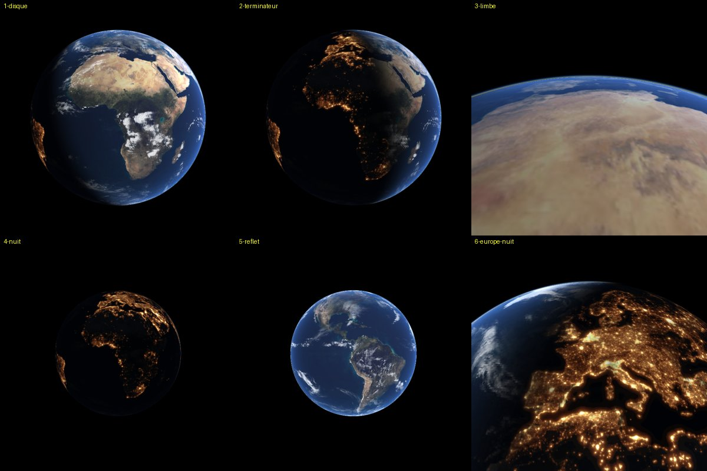
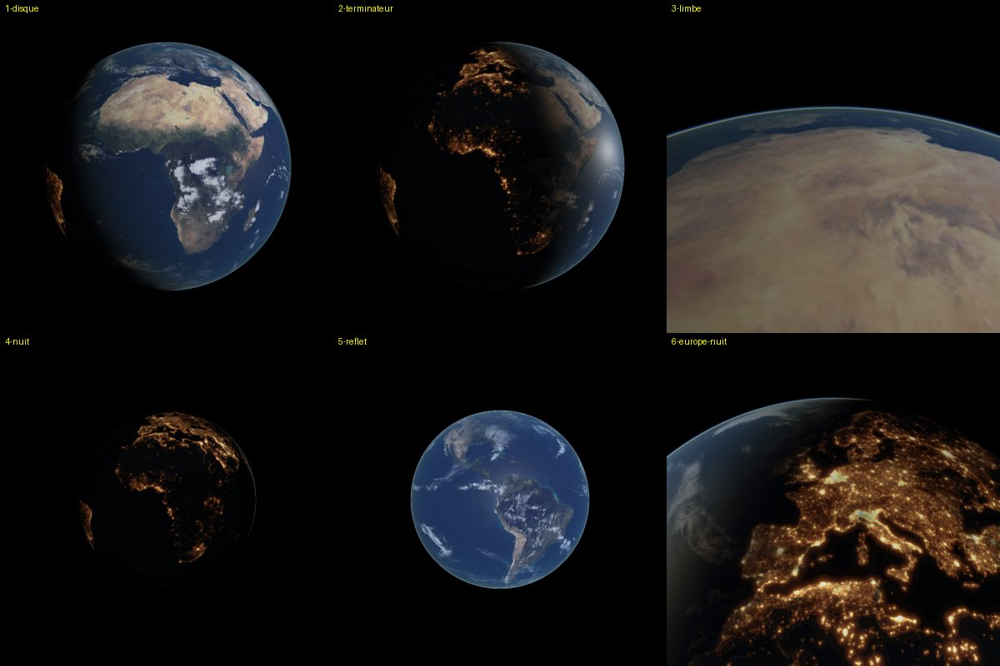
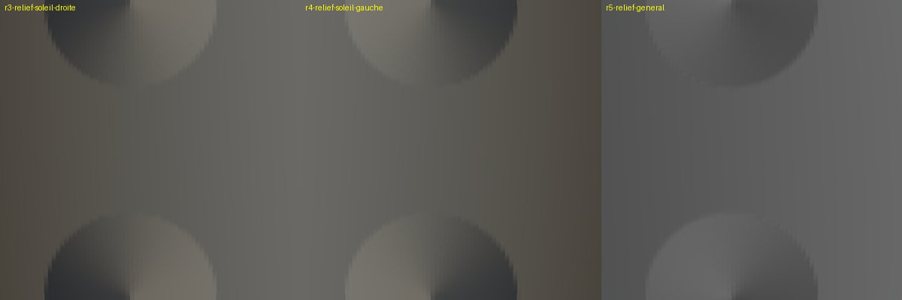
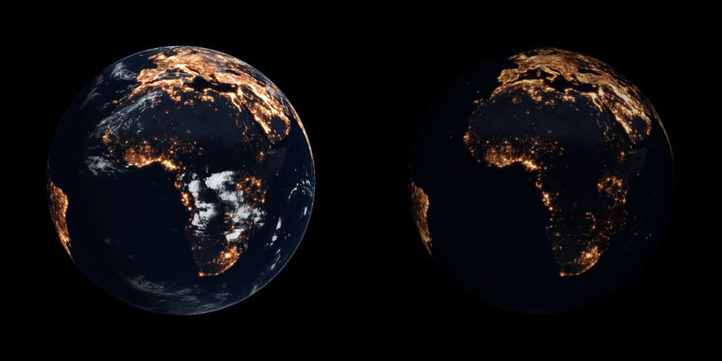
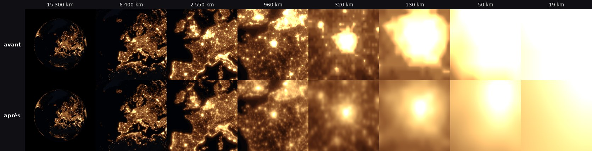
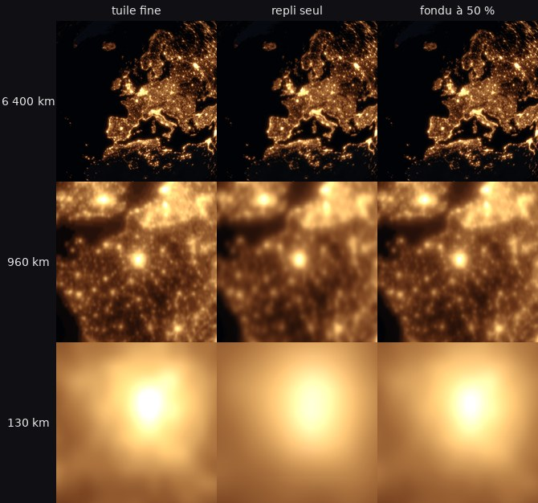

# Audit et remise en état du modèle terrestre — Gobai Space

Rapport de la mission « reconstruction, normalisation et optimisation du modèle planétaire terrestre ». Il suit les
phases de la directive : instruction, diagnostic, plan, corrections, validation, validation visuelle, compte rendu.

## Méthode

- Lecture du code de la Terre et de ses commentaires : moteur (`engine.jsx`), description des astres
  (`tiledBodies.jsx`), tuiles (`tiles/`), atmosphère et nuages (`atmosphere*.jsx`, `weatherFlow.jsx`), sphère de fond
  (`sphereShade.jsx`), interface (`SolarScene.jsx`, `useMapFeeds.jsx`, `Attribution.jsx`), relais du serveur
  (`backend/src/services/map-tiles/earth-*.ts`). Aucun marqueur TODO, FIXME ou HACK ne concerne la Terre.
- Recherche des exports inutilisés dans `moteur/engine` : un seul, propre à la Terre (`FLOW_ACCELERATION`).
- **Banc d'essai visuel** (hors dépôt) : les vrais shaders du projet (tuiles, coquille de diffusion, nuages) sur une
  sphère complète, compilés avec three.js r128 (la version du projet) et rendus dans Chrome sans écran (WebGL 2,
  SwiftShader). Textures d'essai : Terre de jour NASA Blue Marble (2048 px, exemples de three.js), masque des mers,
  nuages, et l'atlas de pollution lumineuse 2025 (niveau 2). Six vues : disque, terminateur, limbe vu de 1 000 km,
  nuit, reflet du Soleil, Europe de nuit ; plus des vues de non-régression et de relief.

## Phase I — Cartographie du système Terre

| Domaine | Fichiers | Rôle | Statut |
| --- | --- | --- | --- |
| Géométrie | `tiles/tileGeometry.jsx`, `tiles/hexCells.jsx`, `tiles/hexDisplay.jsx`, `tiles/mercator.jsx` | Tuiles Web Mercator posées sur la sphère, cellules hexagonales, pentagone aux pôles, sommets relatifs au centre de tuile (précision 32 bits) | Indispensable, correct |
| Niveaux de détail | `tiles/tileLayer.jsx`, `tiles/prefetch.jsx`, `bodyLoading.jsx` | Choix des niveaux à l'écran, fondus entre niveaux, préchargement prédictif, budget d'astres | Indispensable, correct |
| Imagerie | `tiles/tileSource.jsx`, `tiles/earthDirect.jsx`, serveur `earth-sources.ts`, `earth-imagery.service.ts` | Mosaïque de sources (Sentinel-2, orthophotos nationales…), accord des couleurs entre sources, relais du serveur | Indispensable, bien testé (pas vérifiable ici sans réseau) |
| Océans | `tiles/seafloorFusion.jsx`, `tiles/oceanColour.jsx`, serveur `earth-seafloor.ts` | Fonds GEBCO fondus au large, couleur réelle de l'eau (chlorophylle) | Indispensable |
| Relief | `tiles/relief.jsx`, shader des tuiles | Altitudes Terrarium (Mapterhorn, AWS), fonds marins, ombrage | Perfectible : ombrage par une lumière fixe |
| Lumières | `tiles/nightLights.jsx` | Atlas 2025 de D. Lorenz en couleurs naturelles, halo | Correct ; mention jamais affichée |
| Éclairage | `tiles/tileShaders.jsx`, `sphereShade.jsx` | Jour/nuit, terminateur, nuit bleutée, halo du limbe | Perfectible (voir diagnostic) ; formules en double |
| Atmosphère | `atmosphere.jsx`, `atmosphereScatter.jsx`, `atmosphereShaders.jsx`, `atmosphereData.jsx` | Coquille : diffusion simple de Rayleigh et de Mie, 16 × 6 pas | Indispensable, physique ; voile devant le sol réduit à 15 % |
| Nuages | `atmosphereShaders.jsx`, `atmosphereClouds.jsx`, `earthCloudMosaic.jsx`, `weatherFlow.jsx` | Sphère à 8 km, image satellite, grille Open-Meteo ou nuages simulés, déplacés par le vent | Perfectible : éclairage différent du sol |
| Couches | `bordersGeometry.jsx`, `countryLabels.jsx`, `worldLabels.jsx`, `volcanoes.jsx`, `lidarPoints.jsx`, `userMarker.jsx` | Frontières, noms, volcans, LiDAR, position | Hors du rendu de surface, non modifiées |
| Interface | `SolarScene.jsx`, `useMapFeeds.jsx`, `Attribution.jsx`, `Cartographie.jsx` | Réglages, chargement des données, sources | Mentions incomplètes |

Composants partagés avec les autres astres (non-régression exigée) : shader des tuiles (Lune, Mars, Mercure, Titan,
géantes gazeuses, satellites), sphère de fond (tous les astres sans carte), coquille de diffusion (Vénus, Mars).

## Phase II — Diagnostic

### Anomalies avérées

| # | Problème | Origine | Gravité | Correction | Risque |
| --- | --- | --- | --- | --- | --- |
| A1 | Anneau bleu au limbe de la face de nuit (≈ 6 % de luminosité, mesuré : pixels (5, 8, 15) au bord du disque noir) | Halo factice du shader des tuiles : poids `.04 + .96 × jour`, jamais nul la nuit | Faible | Halo factice retiré pour la Terre | Aucun hors Terre (seule la Terre change) |
| A2 | Double halo de jour : halo factice sur le sol en plus de la coquille de diffusion physique | Halo ajouté avant la coquille, gardé ensuite | Moyenne | Le voile est laissé à la coquille, en perspective aérienne (A2 bis) | Teinte du disque modifiée : calibrée au banc |
| A2 bis | Voile de l'atmosphère devant le sol réduit à 15 %, sans atténuation du sol | Réglage pour ne pas « délaver » les cartes avec le halo factice | Moyenne | Perspective aérienne : voile à 50 % et sol, nuages, étoiles atténués par l'air traversé (Terre seulement) | Vénus et Mars inchangées |
| A3 | Sol éclairé à 38 % jusqu'au terminateur, encore éclairé 7° après le coucher du Soleil, aucune couleur de crépuscule | Modèle `col × (.38 + .72·cos)` mélangé par `smoothstep(−.12, .22)` | Moyenne | Modèle physique (A3 bis) | Terre seulement |
| A4 | Nuages éclairés selon une autre courbe que le sol : nuages blancs au-dessus d'un sol déjà sombre au terminateur | Courbe propre aux nuages (`smoothstep(−.1, .25)`), blanc pur | Moyenne | Même modèle que le sol, relevé de 3° (sommet à 8 km) | Aucun (nuages de la Terre seulement) |
| A5 | Relief ombré par une lumière fixe du nord-ouest, quelle que soit la position du Soleil | Ombrage de carte appliqué sur le globe éclairé | Moyenne (cohérence scientifique) | Pente éclairée par le vrai Soleil (Terre, réglage « Ombre » actif) | Ombrage de carte gardé ailleurs |
| A6 | Vue « Pollution lumineuse de toute la Terre » : nuages et voile de l'atmosphère restaient éclairés par le jour | La vue de nuit n'était transmise qu'aux tuiles | Moyenne | Vue de nuit transmise aux nuages et à la coquille | Aucun |
| A7 | Mention de la pollution lumineuse définie mais jamais affichée dans les sources | `EARTH_NIGHT_LIGHTS.attribution` non lu | Faible (licence, traçabilité) | Ajoutée aux sources quand les lumières sont allumées | Aucun |
| A8 | Nuages simulés affichés sans le dire quand aucune donnée réelle n'arrive | Aucune mention de la source des nuages | Faible (cohérence scientifique, §9) | Source des nuages dans les sources : satellite, modèle météo ou simulés | Aucun |
| A9 | Constante `FLOW_ACCELERATION` exportée, jamais lue | Ancienne documentation sous forme de code | Très faible | Supprimée (aucune référence) | Aucun |

### Améliorations (pas des anomalies)

| # | Proposition | Gain | Coût |
| --- | --- | --- | --- |
| B1 | Reflet du Soleil sur la mer (GGX, rugosité de Cox et Munk, Fresnel 2 %), limité à l'eau | Réalisme des océans (point brillant des photos de la Terre) | Masque de 230 Ko, quelques opérations par pixel d'eau |
| B2 | Lumières de la nuit : rien n'est lu côté jour | Cinq lectures de texture en moins par pixel sur la moitié éclairée | Aucun |
| B3 | Formules d'éclairage général mises en commun (`surfaceLight.jsx`) | Une seule définition pour les tuiles et la sphère de fond | Aucun (résultat identique au pixel près) |

## Phase III — Plan suivi

1. Erreurs visuelles : A1, A2, A2 bis, A6.
2. Éclairage : A3, A4, A5, B1.
3. Données et mentions : A7, A8.
4. Code : B3, A9.
5. Performance : B2.
6. Validation : tests, non-régression au pixel près, banc visuel.

## Phase IV — Corrections

- **`surfaceLight.jsx`** (nouveau) : modèle général (inchangé, mis en commun) et modèle de la Terre, en lumière
  linéaire ramenée à l'écran (puissance 1/2,2) :
  - lumière directe : Lambert sur la pente du terrain × transmission de l'air `exp(−τ·(m − 1))`, avec τ = épaisseur
    optique verticale tirée des coefficients de la coquille (`verticalOpticalDepth`, ≈ 0,074 ; 0,136 ; 0,293) et
    m = masse d'air de Kasten et Young (1 au zénith, ≈ 38 à l'horizon) ;
  - lumière du ciel bleutée (≈ 10 % en plein jour), éteinte 6° sous l'horizon ;
  - reflet du Soleil sur l'eau : microfacettes GGX, rugosité √(0,003 + 0,00512 × 7 m/s) ≈ 0,197, Fresnel de Schlick.
- **Shader des tuiles** : `surfModel` = 1 pour la Terre seulement ; directions est et nord calculées au sommet pour
  incliner la normale selon la pente du relief ; halo factice gardé pour les autres astres à atmosphère (Titan,
  géantes gazeuses) ; lumières de la nuit lues seulement côté nuit.
- **Coquille de diffusion** : renvoie aussi la part du fond qui traverse l'air ; pour la Terre (`aerial`), mélange
  « lumière diffusée + fond × transmission » et voile devant le sol à 50 % (compromis expliqué dans `atmosphere.jsx` :
  le mélange se fait sur les couleurs de l'écran, où un voile entier serait surestimé).
- **Nuages de la Terre** : même modèle que le sol ; éteints en vue de nuit.
- **Masque de l'eau** : `frontend/public/data/earth-water-mask.png` (Web Mercator, 2 048 px, ≈ 20 km par pixel),
  fabriqué par `frontend/scripts/masque-eau.py` à partir des pays Natural Earth 1:50 m déjà présents dans le dépôt.
- **Sources** : mention de la pollution lumineuse et de l'origine des nuages.

Aucun fichier supprimé. Aucune API, source de données, variable d'environnement ni réglage Render modifiés.

## Phase V — Validation

- Tests unitaires : 390 tests des modules du moteur, des tuiles, du ciel et du HUD réussis, dont 6 nouveaux
  (masse d'air, transmission, rugosité, formules générales inchangées, branchements du modèle de la Terre, épaisseur
  optique). Quatre tests échouent déjà sur `main`, sans lien avec ce travail (affichage hexagonal, orbites,
  orbites des planètes, Soleil).
- Vérification des imports (`scripts/verifie-imports.mjs`) et de la syntaxe de chaque fichier modifié.
- Compilation des shaders : faite par le banc dans Chrome (WebGL 2), sans erreur ni avertissement.
- **Non-régression au pixel près** (banc, mêmes vues avant et après) : tuiles en modèle général, tuiles sans air (Lune),
  ombrage de relief du modèle général, sphère de fond avec et sans atmosphère : écart maximal 0, aucun pixel différent.
- Non exécutés ici, faute de moyens : rendu dans l'application complète avec les vraies tuiles (réseau fermé),
  déploiement Render (service supprimé), mesures de performance sur de vrais processeurs graphiques, console du
  navigateur dans l'application.

## Phase VI — Validation visuelle

Avant : 

Après : 

- Disque : dégradé naturel jusqu'au terminateur, océans bleus sous le voile de l'air, limbe bleu sans contour factice.
- Terminateur : bande de crépuscule rougie, reflet du Soleil sur l'océan Indien, nuages éteints avec le sol.
- Limbe vu de 1 000 km : voile croissant vers l'horizon, liseré bleu.
- Nuit : limbe noir (plus d'anneau bleu), lumières inchangées.
- Reflet du Soleil : point brillant diffus sur la mer, absent des terres.

Relief éclairé par le Soleil (cônes d'essai) : Soleil à droite, Soleil à gauche, puis l'ancien ombrage fixe du
nord-ouest, gardé quand l'ombre jour/nuit est coupée :

Vue « Pollution lumineuse de toute la Terre », avant et après :

## Phase VII — Compte rendu

**Fichiers créés** : `frontend/src/moteur/engine/surfaceLight.jsx`, `surfaceLight.test.jsx`,
`frontend/scripts/masque-eau.py`, `frontend/public/data/earth-water-mask.png`, ce rapport et ses images.

**Fichiers modifiés** : `tiles/tileShaders.jsx`, `tiles/tileLayer.jsx`, `tiles/tileManager.jsx`, `tiledBodies.jsx`,
`engine.jsx`, `sphereShade.jsx`, `atmosphere.jsx`, `atmosphereData.jsx` (+ test), `atmosphereScatter.jsx`,
`atmosphereShaders.jsx`, `weatherFlow.jsx`, `SolarScene.jsx`, `scene/useMapFeeds.jsx`.

**Compromis**
- Voile de l'atmosphère devant le sol à 50 % et non 100 % : le mélange se fait après la correction gamma.
- Lacs intérieurs comptés comme de la terre dans le masque (inclus dans les pays de Natural Earth) : pas de reflet.
- Masque à ≈ 20 km par pixel : au plus près d'une côte, le reflet déborde de quelques kilomètres.

**Problèmes persistants et recommandations**
- Perspective aérienne en lumière linéaire : demanderait un rendu intermédiaire en haute dynamique et une passe finale ;
  elle permettrait le voile entier.
- Ombres des nuages sur le sol, et lumière des villes diffusée par les nuages.
- Calottes polaires au-delà de 85,05° : la dernière rangée Web Mercator y est étirée (glace, peu visible).
- Masque des lacs (Natural Earth « lakes », absent du dépôt).
- Le modèle 3D de la Lune garde sa propre copie des formules de Lommel-Seeliger (hors périmètre Terre).
- Validation sur téléphone et ordinateur réels, et sur Render une fois le service recréé.

## Addendum — Visibilité multi-échelle de la pollution lumineuse

### Diagnostic de l'existant

- **Saut au chargement** : une tuile affichée passait d'un coup de la mosaïque mondiale à sa tuile de l'atlas.
- **Halo lié à la tuile** : le halo était pris dans la tuile de la vue (biais de 1 à 4 niveaux). De près, ces niveaux
  restent la tuile agrandie, si bien que le halo s'ajoutait à la ville elle-même. Résultat : saturation en blanc
  au-dessous de 300 km d'altitude (100 % de l'image à 50 km).
- **Pixels agrandis** : au-delà du niveau 6 de l'atlas, les pixels apparaissaient en carrés (lissage bilinéaire seul).
- **Moyenne en valeurs d'affichage** : les mipmaps moyennaient des couleurs sRGB et non de la lumière. Une petite ville
  lointaine s'éteignait plus vite que sa lumière réelle.
- **Mosaïque mondiale de 4 096 px** : ≈ 85 Mo sur la carte graphique, chargée seulement dans certains cas.

### Architecture retenue

| Échelle | Source | Lecture |
|---|---|---|
| Globe entier, vue lointaine | mosaïque mondiale permanente (2 048 px, ≈ 21 Mo), chargée dès que les lumières sont allumées | mipmaps en lumière linéaire |
| Région, continent | tuile de l'atlas (1 024 px, niveaux 0 à 6) partagée par toutes les tuiles affichées qu'elle couvre | mipmaps, niveau de détail calculé au pixel |
| Ville, rue (au-delà du niveau 6) | même tuile, agrandie | interpolation bicubique B-spline (sans dépassement, sans détail inventé) |
| Pendant un chargement | ancêtre déjà sur la carte graphique, sinon mosaïque mondiale | même lecture, puis fondu de 400 ms vers la tuile fine (immédiat si les animations sont réduites) |
| Halo d'objectif | mosaïque mondiale (une seule image : ni raccord entre tuiles, ni coupure à l'antiméridien) | quatre niveaux pesés par le flou réel à l'écran : plein de loin, effacé de près |

- **Chargement selon la caméra** : seules les tuiles visibles demandent leurs lumières, au plus bas de la file (après
  les images et le relief). Les demandes qui ne servent plus sont annulées quand la vue change.
- **Préchargement des zones voisines** : avec le préchargement prédictif (vue dans 1,5 s, cône de 120°), au plus
  8 tuiles natives voisines, après les lumières visibles. Ces demandes sont annulées dès qu'un zoom commence.
- **Réutilisation** : une image reçue reste partagée 30 s par la source, puis par le cache du navigateur.
- **Libération** : la texture d'une tuile est rendue quand plus aucune tuile affichée ne s'en sert, et le repli est
  rendu à la fin du fondu.
- **Cohérence radiométrique** : les images sont stockées en sRGB sur la carte graphique (WebGL 2). Les mipmaps
  moyennent donc la lumière elle-même, et la courbe sRGB exacte la ramène à l'affichage. Les zones les plus sombres
  de l'atlas ne sont ni éclaircies ni grisées, et aucun foyer n'est créé.
- **Compatibilité** : sans lecture à niveau imposé (WebGL 1 sans extension), lecture par biais et agrandissement
  bilinéaire, vérifiés au banc.

### Validation

Série de zoom sur Paris (banc, mêmes vues avant et après, Soleil derrière la Terre), centre de l'image :

| Altitude | Luminosité moyenne avant → après | Part saturée en blanc avant → après |
|---|---|---|
| 15 300 km | 31,4 → 33,4 | 0,1 % → 0,1 % |
| 6 400 km | 59,8 → 60,3 | 0,5 % → 0,3 % |
| 2 550 km | 88,9 → 86,6 | 2,4 % → 0,6 % |
| 960 km | 89,9 → 86,8 | 2,8 % → 0,6 % |
| 320 km | 177,8 → 153,3 | 24,7 % → 3,9 % |
| 130 km | 243,8 → 209,1 | 74,5 % → 21,8 % |
| 50 km | 253,8 → 224,5 | 100 % → 23,8 % |
| 19 km | 255 → 226,4 | 100 % → 4,7 % |

De loin, la luminosité est la même : rien n'est éclairci en dézoomant. De près, la saturation disparaît et les
villes restent lisibles.

Continuité pendant un chargement : tuile fine, repli seul (ancêtre ou mosaïque) et fondu à mi-course. L'écart de
luminosité moyenne entre les trois reste sous 2 %.

- Tests unitaires : 395 réussis, dont 5 nouveaux (halo selon l'échelle, poids bicubiques, repli sur l'ancêtre,
  continuité dans le shader, préchargement des voisines). Les quatre échecs déjà présents sur `main` sont inchangés.
- Non-régression au pixel près : tuiles sans lumières (Lune, Mars, autres astres), relief, sphère de fond avec et
  sans air : écart 0.
- Non exécutés ici : téléphone et ordinateur réels, application complète avec les vraies tuiles (réseau fermé),
  Render (service supprimé).
